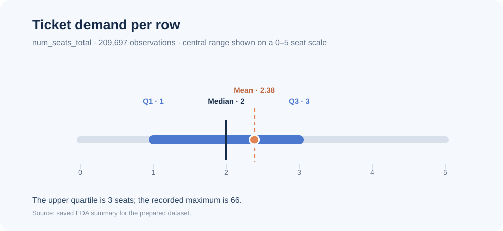
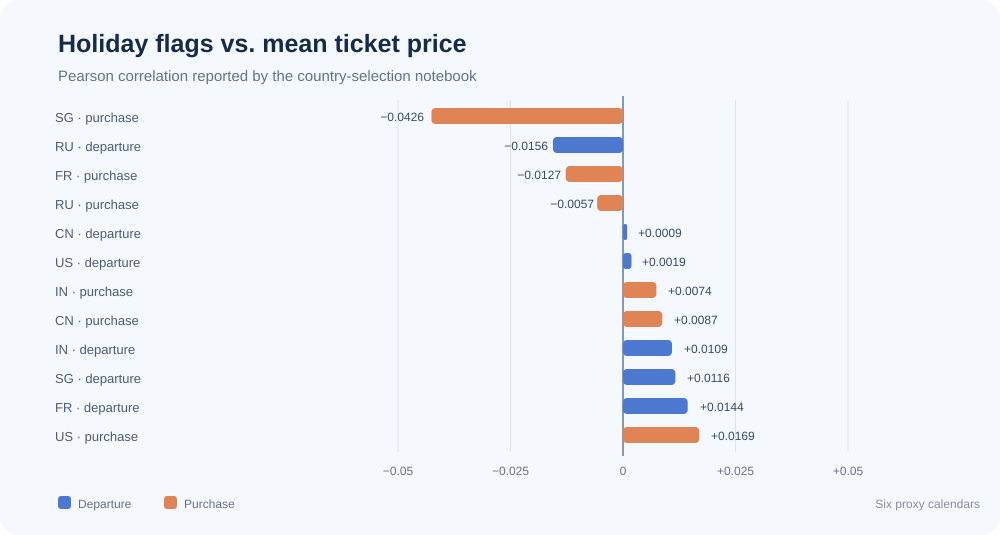
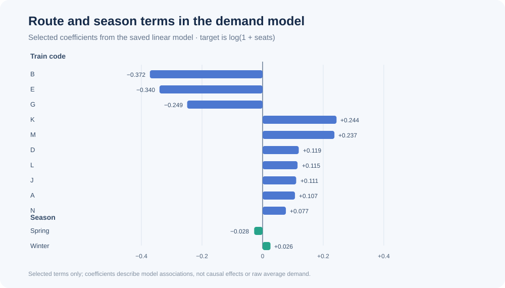
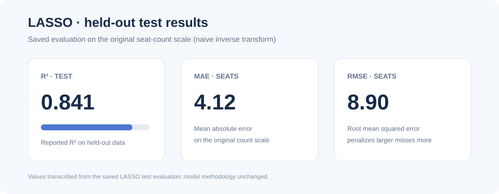

# Train Ticket Demand Prediction

A data science project exploring train ticket sales and predicting ticket demand using feature engineering, exploratory data analysis, and regression models.

The project follows an end-to-end machine learning workflow, from raw data preparation and feature engineering to model training, comparison, and evaluation.

## Project Workflow

The project is organized into Jupyter notebooks and a supplementary Python command-line adapter.

| Notebook / File | Description |
|---|---|
| `0_country_selection.ipynb` | Selects the country and corresponding holiday calendar, followed by initial data exploration. |
| `1_feature_gen_data_cleaning.ipynb` | Cleans the dataset and generates date-based, holiday, and route-level features. |
| `2_model_training.ipynb` | Trains and compares regression models for ticket demand estimation. |
| `Models_Finetuned.ipynb` | Explores an alternative, fine-tuned demand-modelling workflow. |
| `train_demand_adapter.py` | Provides a command-line interface for training and evaluating Statsmodels and scikit-learn models. |

## Exploratory Data Analysis & Results

| Ticket demand | Holiday correlations |
|---|---|
| <br>*The middle half of observations is 1–3 seats; the mean is 2.38, with a long upper tail.* | <br>*Holiday-flag correlations with mean ticket price are small across the six proxy calendars; correlation is not causation.* |

| Route and season model terms | Held-out model evaluation |
|---|---|
| <br>*The fitted log-demand model assigns different coefficients to train codes; seasonal terms shown are comparatively small.* | <br>*The saved LASSO test evaluation reports R² 0.841, MAE 4.12 seats, and RMSE 8.90 seats.* |

## Getting Started

### Prerequisites

- Python 3.13 or later
- [Poetry](https://python-poetry.org/)

### Installation

Clone the repository and navigate to its root directory:

```bash
git clone <repository-url>
cd train-ticket-demand-prediction
```

Install the required dependencies:

```bash
poetry install
```

### Running the Notebooks

Launch Jupyter Notebook within the Poetry environment:

```bash
poetry run jupyter notebook
```

Run the first three notebooks sequentially:

1. **Country Selection:** Selects the country and holiday calendar and inspects the source dataset.
2. **Feature Engineering:** Cleans the data and generates the features required for modelling.
3. **Model Training:** Uses the processed dataset to train and evaluate regression models.

`Models_Finetuned.ipynb` provides an alternative modelling workflow.

### Running the Command-Line Adapter

The adapter accepts a prepared feature dataset and saves model reports and trained artifacts to a specified output directory.

```bash
poetry run python train_demand_adapter.py \
    --csv train_sales_features.csv \
    --out outputs
```

## Data and Generated Files

The project uses the following datasets:

- `train_sales.csv` – Original train ticket sales dataset.
- `train_sales_features.csv` – Processed dataset generated by the feature engineering notebook and used for model training.

The feature dataset can be recreated by running the notebooks in sequence.

Model reports, trained artifacts, and other generated outputs can be reproduced by running the respective workflows. 

## Requirements and Reproducibility

Project dependencies are managed using Poetry. Refer to `pyproject.toml` and `poetry.lock` for the dependency specifications.

For reproducibility, run the notebooks in the documented order and ensure the required input dataset is available.
